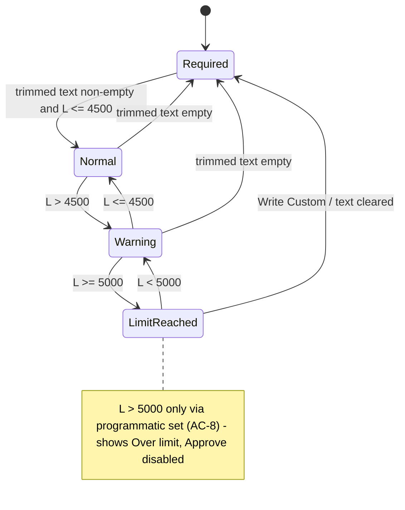

# Spec: Resolution character counter | SPEC-2026-10-11-resolution-char-counter | Status: draft
Supersedes: N/A
Related: N/A

Scope: frontend only (`app/_components/TicketDetailPanel/`). Single module.

## Problem and why
When a manager writes the reply to the customer in the ticket resolution editor, the footer only shows "✓ N characters". There is no length limit and no warning, so a reply can grow without bound. That is inconsistent with the customer-facing ticket form, which caps the description at 5000 characters. After this change the editor shows "used / limit" under the field, stops input at a hard limit of 5000 characters, and warns, without relying on color alone, as the manager nears the limit.

## Goals / Non-goals
**Goals:**
- Show a live "used / limit" counter in the existing footer row under the resolution textarea, replacing "✓ N characters".
- Enforce a hard limit of 5000 characters on manager input in the editor.
- Show three visual states (normal / warning / limit reached). Each state is conveyed by text and color, not by color alone.
- Announce threshold changes to assistive technology politely, not on every keystroke.
- Define one shared constant for the resolution limit (5000) that the editor and its behavior reference.
- Keep the "⚠️ Resolution required" state for empty or whitespace-only text.

**Non-goals:**
- No backend, tRPC, API, database or LangGraph changes. The `approve` input schema and the `tickets.resolution` column (`text`) stay as they are. Server-side enforcement of the limit is out of scope.
- No change to `TicketForm` (subject 500, description 5000) or to `ticketFormSchema`. They are not migrated to the new constant in this spec.
- No change to the visual behavior of the shared `Textarea` component for its existing consumers (label-row counter, orange warning above 90%).
- No change to the Approve modal preview truncation (`RESOLUTION_PREVIEW_LENGTH` = 200).
- No grapheme-aware counting (see AC-12).
- No rich text or formatting in the resolution.

## User stories
- US-1: As a manager, I want to see how many characters I have used out of the allowed limit while I type the reply, so that I can keep it within bounds.
- US-2: As a manager, I want the counter to warn me when I am close to the limit and tell me clearly when I reach it, so that I am not surprised when typing stops.
- US-3: As a manager, I want "Use AI Solution" to give me a reply that fits the limit, so that I can approve without manual trimming.
- US-4: As a manager using a screen reader, I want to hear when I approach or reach the limit without the counter being read on every keystroke, so that I get the information without noise.
- US-5: As a manager, I want to keep being told when the resolution is empty, so that I do not try to approve a blank reply.

## Acceptance criteria (EARS)

### Limit and enforcement
- **AC-1:** The system shall define the resolution character limit as a single shared constant with the value 5000, and the editor's input limit, counter and truncation behavior shall all derive from that constant (no other 5000 literal for the resolution).
  `observable: code review / unit test importing the constant; changing it changes the counter's limit and the textarea maxlength`
- **AC-2:** The system shall set the native maximum length of the resolution textarea to the resolution limit, so that typing or pasting cannot make the field longer than the limit.
  `observable: unit test — textarea has attribute maxlength="5000"; E2E — typing past 5000 characters leaves the value at 5000`
- **AC-3:** WHEN the manager pastes text that would make the field exceed the limit, the system shall keep only as much of the pasted text as fits within the limit (native browser behavior) and shall show the counter in the limit-reached state.
  `observable: E2E (Playwright) — fill 4990 chars, paste 50 chars → value length 5000, counter "5000 / 5000" in limit-reached state`
- **AC-4:** WHEN the manager activates "Use AI Solution" and the suggested solution is longer than the limit, the system shall set the resolution text to the first 5000 characters of the suggested solution (truncation by string length) and shall show the counter in the limit-reached state. *(Assumption A-2.)*
  `observable: unit test — suggestedSolution = "A".repeat(10000), click → onResolutionChange called with a 5000-char string`
- **AC-5:** WHEN the manager activates "Use AI Solution" and the suggested solution is at or below the limit, the system shall set the resolution text to the suggested solution unchanged.
  `observable: unit test — onResolutionChange called with the exact suggestedSolution`
- **AC-6:** WHEN the editor truncates a suggested solution under AC-4, the system shall show a visible text notice next to the counter stating that the AI solution was shortened to the limit (e.g. "AI solution shortened to 5000 characters"), and shall announce it through the polite live region (AC-14). The notice shall disappear when the manager next edits the text or activates "Write Custom". [NEEDS CLARIFICATION: Q-1 exact copy]
  `observable: unit test — after truncating click, notice text is present; after a change event it is gone`
- **AC-7:** WHEN the manager activates "Write Custom", the system shall clear the resolution text, and the footer shall show the "⚠️ Resolution required" state (existing behavior kept).
  `observable: unit test — onResolutionChange("") called; with resolutionText="" the required message is shown`
- **AC-8:** IF the resolution text received by the editor is already longer than the limit (for example a similar ticket's resolution selected in the panel, or any other programmatic set that bypasses the native maximum length), THEN the system shall show the true length against the limit (e.g. "6200 / 5000") in the limit-reached state with an over-limit text label, and the panel shall keep the Approve action disabled until the text is at or below the limit. *(Assumption A-3.)*
  `observable: unit test — resolutionText="A".repeat(6200) → counter "6200 / 5000", over-limit label; panel test — Approve button disabled`

### Counter display and states
- **AC-9:** WHILE the trimmed resolution text is non-empty, the system shall show the counter as "<used> / <limit>" (e.g. "1234 / 5000") in the footer row directly under the textarea, in place of the former "✓ N characters" text.
  `observable: unit test — resolutionText="Hello world" → "11 / 5000" visible; "✓ 11 characters" absent`
- **AC-10:** WHILE the resolution text is empty or whitespace-only, the system shall show "⚠️ Resolution required" in red in the footer row instead of the counter (existing text and styling kept).
  `observable: unit test — resolutionText="" and "   " → "⚠️ Resolution required" with class text-red-500; no "/ 5000" counter`
- **AC-11:** The system shall classify the counter state from the used length L and limit M as follows: **normal** WHILE L ≤ 0.9 × M (L ≤ 4500); **warning** WHILE 0.9 × M < L < M (4501–4999); **limit reached** WHILE L ≥ M (L ≥ 5000).
  `observable: unit tests at L = 4500 (normal), 4501 (warning), 4999 (warning), 5000 (limit reached)`
- **AC-12:** The system shall measure the used length as the JavaScript string length of the resolution text (UTF-16 code units), including whitespace and newlines and without trimming. This is the same measure the native maximum length uses, so an emoji outside the Basic Multilingual Plane counts as 2.
  `observable: unit test — "😀" counts as 2; "Hello\nWorld" counts as 11; "  abc  " counts as 7`
- **AC-13:** The system shall convey each counter state through text as well as color:
  - normal: neutral color, no extra label;
  - warning: orange color plus a visible text label (e.g. "Approaching limit");
  - limit reached: red color plus a visible text label (e.g. "Limit reached", or "Over limit" for AC-8).
  With color removed (grayscale), the state shall still be identifiable from the text. [NEEDS CLARIFICATION: Q-1 exact copy]
  `observable: unit test — at 4600 the label "Approaching limit" is present; at 5000 "Limit reached" is present; at 100 neither is present`

### Accessibility
- **AC-14:** WHEN the counter state changes (normal → warning, warning → limit reached, limit reached → warning, warning → normal, or to/from the over-limit state), the system shall announce the new state once through a polite live region (aria-live="polite"), e.g. "Approaching limit: 4501 of 5000 characters used".
  `observable: unit test — live region text changes only at threshold crossings; axe/jest-axe passes`
- **AC-15:** WHILE the counter state does not change between keystrokes, the system shall not update the live region's content, so screen readers do not announce the count on every keystroke.
  `observable: unit test — rerender 4600 → 4601 → 4602: live region text unchanged`
- **AC-16:** The system shall link the counter (and any truncation notice) to the textarea as its accessible description, so that a screen reader user who focuses the field can hear "<used> of <limit> characters" on demand.
  `observable: unit test — textarea aria-describedby references the counter element's id`
- **AC-17:** The resolution textarea shall have an accessible name (e.g. "Resolution"), so that the description and announcements are tied to a named field. [NEEDS CLARIFICATION: Q-3 visible label vs aria-label]
  `observable: getByRole("textbox", { name: /resolution/i }) resolves`
- **AC-18:** The counter's text and the warning and limit-reached labels shall meet WCAG 2.1 AA contrast (≥ 4.5:1) against the card background.
  `observable: jest-axe color-contrast rule / manual contrast check of chosen Tailwind shades`

### Compatibility
- **AC-19:** The system shall leave the shared Textarea component's existing behavior unchanged for current consumers (label-row counter rendered only with `label`, orange warning only above 90%), and `tests/accessibility/textarea-component.test.tsx`, `components/ui/__tests__/textarea.test.tsx` and the TicketForm tests shall pass without modification.
  `observable: CI — those suites green with no diff to their files`

## Edge cases
- **Empty text** → "⚠️ Resolution required", no counter (AC-10).
- **Whitespace-only text** (e.g. "   ", "\n\n") → "⚠️ Resolution required" (AC-10), even though the raw length is > 0.
- **Whitespace-only text near the limit** (e.g. 4600 spaces) → still "⚠️ Resolution required"; the required state wins over the warning state. Accepted: approval is already blocked for whitespace-only text.
- **Leading/trailing whitespace with content** → counter counts the untrimmed length (AC-12), matching current behavior.
- **Exactly 90% (4500)** → normal (AC-11).
- **4501** → warning (AC-11).
- **Exactly 100% (5000)** → limit reached; further typing is blocked natively (AC-2, AC-11).
- **Paste over the limit** → native truncation to 5000, limit-reached state (AC-3).
- **AI solution longer than the limit** → truncated to 5000 and a notice is shown (AC-4, AC-6).
- **AI solution exactly 5000** → set unchanged, limit-reached state, no truncation notice (AC-5).
- **Truncation that would split a surrogate pair** (5000th code unit is the high half of an emoji) → accepted risk. Slicing by string length may leave a lone high surrogate at the end. [NEEDS CLARIFICATION: Q-2 whether to drop a trailing lone surrogate]
- **Emoji / astral characters** → counted as 2 per character (AC-12). Combining sequences such as flags or ZWJ families count as their full code-unit length. Accepted: matches native `maxlength`.
- **Multi-byte but BMP characters** (Cyrillic, CJK, accented Latin) → count 1 each (AC-12).
- **Newlines** → `\n` counts 1 (AC-12). Accepted risk: any browser that counts a line break as 2 against native `maxlength` could stop input a few characters before the counter reaches 5000. Verify in E2E on Chromium.
- **Similar-ticket resolution longer than 5000 selected from the panel** → over-limit display and Approve disabled (AC-8). The text is not auto-truncated (A-3).
- **Rapid typing across the threshold** → only the crossing is announced (AC-14, AC-15).
- **Limit reached then deleting one character** → warning state and one polite announcement (AC-14).
- **suggestedSolution absent** → "Use AI Solution" is not rendered (existing behavior). Nothing changes.

## Data model / Schema
No new entities. One new shared constant: **Resolution limit** = 5000 characters (frontend only).

## Workflows

Counter state machine (L = used length of the untrimmed text, M = 5000; "Required" applies when the trimmed text is empty):

"Use AI Solution" flow:
1. Manager clicks "Use AI Solution".
2. If the suggested solution length ≤ 5000 → resolution text = suggested solution (AC-5).
3. Otherwise → resolution text = first 5000 characters, truncation notice shown and announced (AC-4, AC-6).
4. Counter updates to the matching state. If the state changed, it is announced politely (AC-14).

## Service communication
Not applicable. No cross-module or network interaction is added. The approve mutation keeps receiving `resolution` unchanged in shape.

## Contracts (high-level)
Not applicable. No new APIs. `ResolutionEditor` props (`resolutionText`, `onResolutionChange`, `suggestedSolution?`) stay the same. The panel's existing Approve-disabled condition is extended by AC-8 (empty OR over limit).

## Non-functional
- **Perf:** WHEN the resolution text is 5000 characters, each keystroke shall update the counter within one render frame (< 16 ms of added work on a mid-range laptop). The counter does only a length computation and a threshold comparison.
- **A11y:** The counter states shall be distinguishable without color (AC-13). Text contrast shall be ≥ 4.5:1 (AC-18). The live region shall announce at most once per state change (AC-14, AC-15). jest-axe shall report zero violations for the editor in all four states (required, normal, warning, limit reached).

## Inputs (provenance)
- Resolution text → [deterministic: panel state in `TicketDetailPanel/index.tsx`, set by typing, "Write Custom", "Use AI Solution" or similar-ticket selection]
- Suggested solution → [reused: existing `suggestedSolution` prop from the AI analysis, no new LLM call]
- Limit → [deterministic: shared constant, AC-1]

## Untrusted inputs
The resolution text (typed or pasted by the manager), the AI-suggested solution, and similar-ticket resolutions are treated as plain data. They are only measured (`length`), sliced and rendered as text through React escaping. They are never interpreted as markup or instructions, and no `dangerouslySetInnerHTML` is introduced. The live-region announcement contains only counts and fixed labels, never user text.

## Verification hints
- AC-1 → code review plus grep: no stray `5000` for the resolution in `TicketDetailPanel/`.
- AC-2, AC-3 → unit: `maxlength` attribute; E2E (Playwright): type/paste beyond the limit.
- AC-4, AC-5, AC-6 → unit: click "Use AI Solution" with 10000 / 5000 / 100-char suggestions and assert the `onResolutionChange` argument and the notice.
- AC-8 → unit: render with 6200 chars; panel test: Approve disabled.
- AC-9 to AC-13 → unit: render at L = 0, whitespace, 11, 4500, 4501, 4999, 5000 and assert text, label and color class.
- AC-14, AC-15 → unit: rerender across and within thresholds and inspect the `aria-live="polite"` region's text.
- AC-16, AC-17 → unit: `aria-describedby` / accessible name queries; jest-axe in `tests/accessibility/`.
- AC-19 → CI: shared Textarea and TicketForm suites green with no diff.

### Existing tests affected
These tests assert the replaced footer and **must be updated** as part of the implementation. They cannot pass unchanged, because AC-9 removes "✓ N characters":
- `app/_components/TicketDetailPanel/__tests__/ResolutionEditor.test.tsx`: assertions on `"✓ N characters"` and `/✓ \d+ characters/` and the `text-green-600` class (lines ~314–410, 474, 661, 696, 712). The test "handles very long suggestedSolution" (~486) expects `onResolutionChange` to be called with the full 10000-char string, which conflicts with AC-4.
- `tests/integration/components/resolution-editor.test.tsx`: assertions on `"✓ N characters"` / `text-green-600` (lines ~410–458, 558–596, 651–695). "should handle very long resolution text" (~577) expects `"✓ 10000 characters"`, which becomes the AC-8 over-limit display.

These tests **must keep passing unchanged**:
- All `"⚠️ Resolution required"` / `text-red-500` assertions in both files above (AC-10 keeps them).
- `tests/accessibility/textarea-component.test.tsx`, `components/ui/__tests__/textarea.test.tsx`, `app/_components/__tests__/TicketForm.test.tsx`, `tests/integration/components/ticket-form.test.tsx`, `tests/accessibility/ticket-form.test.tsx` (AC-19).
- `ApproveModal` tests (`__tests__/ApproveModal.test.tsx`, `tests/integration/components/approve-modal.test.tsx`, `tests/accessibility/approve-reject-modals.test.tsx`). Preview behavior is unchanged.
- Panel tests (`__tests__/index.test.tsx`, `tests/integration/components/ticket-detail-panel-index.test.tsx`) for the empty-text Approve-disabled behavior.

## Assumptions
- **A-1:** No shared length constant exists today (TicketForm and `ticketFormSchema` use literal 500/5000). A new resolution-limit constant is introduced. Migrating TicketForm to it is out of scope.
- **A-2:** Over-limit AI solutions are **truncated** to the limit rather than rejected or left over the limit. Rationale: the limit is hard by decision, "Use AI Solution" is a one-click convenience whose output the manager reviews and edits before approving, and truncation keeps the field consistent with native `maxlength` (which also truncates on paste). The visible notice (AC-6) keeps the truncation from being silent.
- **A-3:** Text that reaches the editor already over the limit through another path (similar-ticket selection) is **not** auto-truncated by the editor. It is shown as over limit, and Approve is blocked until the manager shortens it. Rationale: the editor should not rewrite values its parent owns without a user action. Applying AI-style truncation to similar-ticket selection as well is the alternative (Q-4).
- **A-4:** The counter uses `string.length` (UTF-16 code units) to match native `maxlength`. The counter and the input limit never disagree.
- **A-5:** The editor implements the counter in its own footer and does not reuse the shared Textarea's label-row counter. That counter renders only with `label` and sits above the field, and changing it would break AC-19. Passing `maxLength` without `showCharCount` to the shared Textarea does not render its counter, so the native limit can be set safely.
- **A-6:** The limit is enforced client-side only. The `approve` endpoint still accepts longer text from other clients (accepted risk, non-goal).

## [NEEDS CLARIFICATION]
- **Q-1:** Exact copy for the warning label, limit-reached label, over-limit label, truncation notice and live-region announcement. The spec uses placeholders: "Approaching limit", "Limit reached", "Over limit", "AI solution shortened to 5000 characters".
- **Q-2:** When truncating an AI solution at 5000 code units splits an emoji (surrogate pair), should the trailing lone surrogate be dropped (result 4999)? The default in this spec is a plain slice.
- **Q-3:** Should the textarea get a visible "Resolution" label or only an `aria-label` (the card heading "✍️ Resolution" is currently visual only)?
- **Q-4:** Should selecting a similar ticket's resolution longer than 5000 also be truncated (like AC-4) instead of the over-limit + Approve-disabled behavior in AC-8? This touches `TicketDetailPanel/index.tsx` (same module).
